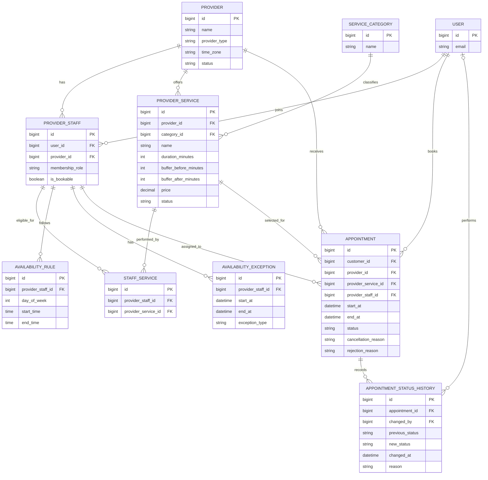

# SlotWise — Conceptual Data Model

**Document:** Conceptual Data Model  
**Version:** 1.0 (Draft)  
**Status:** Proposed

## 1. Purpose

This document describes the main business entities within SlotWise and their relationships.

SlotWise is a multi-industry appointment booking platform supporting individual service providers and businesses with multiple employees.

The conceptual data model provides the foundation for subsequent logical and physical database design.

## 2. Core Entities

### 2.1 User

Represents an individual who has an account on SlotWise.

A user may act as a customer, individual provider, business owner, administrator or employee, depending on their roles and permissions.

### 2.2 Provider

Represents a service provider registered on SlotWise.

Supported provider types:

- INDIVIDUAL
- BUSINESS

An individual provider represents a professional managing their own services and appointments.

A business provider represents an organization managing services and multiple employees.

### 2.3 ProviderStaff

Associates user accounts with provider accounts.

This entity supports:

- Individual providers.
- Business owners.
- Business administrators.
- Employees.

It also stores provider-level membership roles and bookability information.

A user may potentially belong to multiple providers.

### 2.4 ServiceCategory

Represents a category used to classify services.

Examples:

- Healthcare.
- Beauty and wellness.
- Education.
- Consulting.
- Home maintenance.

### 2.5 ProviderService

Represents a service offered by a provider.

Each service belongs to a provider and a service category.

A service includes information such as:

- Service name.
- Description.
- Duration.
- Price.
- Before-service buffer.
- After-service buffer.
- Active or inactive status.

Service durations and prices may differ between providers offering similar services.

### 2.6 StaffService

Defines which services a particular employee is eligible to perform.

This entity establishes a many-to-many relationship between ProviderStaff and ProviderService.

Only employees associated with the selected service shall be considered for automatic appointment assignment.

### 2.7 AvailabilityRule

Stores recurring working schedules for individual bookable employees.

Examples include:

- Monday: 09:00–17:00.
- Tuesday: 09:00–17:00.
- Wednesday: 10:00–18:00.

Each employee may have multiple availability rules.

### 2.8 AvailabilityException

Stores temporary changes to an employee's normal availability.

Examples include:

- Leave.
- Breaks.
- Holidays.
- Additional working hours.
- Temporary unavailable periods.

### 2.9 Appointment

Represents a booking made by a customer.

Each appointment records:

- Customer.
- Provider.
- Selected service.
- Automatically assigned employee.
- Appointment start and end timestamps.
- Appointment status.
- Relevant cancellation or rejection information.

### 2.10 AppointmentStatusHistory

Records appointment status changes over time.

Each status history record shall capture:

- Appointment.
- Previous status.
- New status.
- User who performed the action.
- Date and time of the change.
- Optional reason or remarks.

This entity provides an audit trail of appointment lifecycle changes.

## 3. Entity Relationships

- A User may have multiple ProviderStaff memberships.
- A Provider may have multiple ProviderStaff members.
- A Provider may offer multiple ProviderServices.
- A ServiceCategory may classify multiple ProviderServices.
- A ProviderStaff member may be eligible for multiple ProviderServices.
- A ProviderService may be associated with multiple eligible ProviderStaff members.
- A ProviderStaff member may have multiple AvailabilityRules.
- A ProviderStaff member may have multiple AvailabilityExceptions.
- A User may create multiple Appointments as a customer.
- A Provider may receive multiple Appointments.
- A ProviderService may be selected for multiple Appointments.
- A ProviderStaff member may be assigned to multiple Appointments over time.
- An Appointment may have multiple AppointmentStatusHistory records.

## 4. Appointment Lifecycle

The proposed appointment statuses are:

| Status | Description |
|---|---|
| PENDING_APPROVAL | Booking has been submitted and is awaiting provider approval |
| CONFIRMED | Provider has approved the appointment |
| REJECTED | Provider has declined the booking |
| IN_PROGRESS | The service is currently being delivered |
| COMPLETED | The service has been completed |
| CANCELLED | The appointment has been cancelled |
| NO_SHOW | Customer did not attend the appointment |

Proposed lifecycle:

PENDING_APPROVAL → CONFIRMED → IN_PROGRESS → COMPLETED

Alternative transitions:

- PENDING_APPROVAL → REJECTED
- PENDING_APPROVAL → CANCELLED
- CONFIRMED → CANCELLED
- CONFIRMED → NO_SHOW

Status transitions shall be validated according to business rules.

### Cancellation information

Cancellation information shall be stored separately from the appointment status.

Proposed attributes:

- cancellation_reason
- cancelled_at
- cancelled_by

### Rejection information

When a provider rejects a booking, the system shall optionally record a rejection reason.

Proposed attribute:

- rejection_reason

### Status history

Every valid appointment status transition shall be recorded in AppointmentStatusHistory.

## 5. Automatic Staff Assignment

SlotWise shall automatically assign an eligible employee when a customer submits an appointment booking.

The assignment process shall consider:

- Provider membership.
- Employee bookability.
- Staff-service eligibility.
- Employee working schedules.
- Availability exceptions.
- Existing appointments.
- Service duration and applicable buffers.

The initial assignment strategy shall use the first eligible employee successfully reserved by the booking process.

The assignment strategy may be enhanced in future releases.

## 6. Time-Slot Generation

SlotWise shall dynamically generate available appointment time slots.

The platform shall use a fixed 15-minute candidate start-time interval.

Employees shall be able to manage their own working schedules, breaks and availability exceptions, subject to provider permissions.

The slot generation interval shall not be configurable by individual employees.

Available slots shall be calculated from scheduling information and existing appointments rather than stored as permanent database records.

## 7. Conceptual Relationship Diagram

The following diagram illustrates the main entities and relationships.

## 8. Appointment Approval and Cancellation

Appointment approval shall be performed by authorized provider-side users.

The supported approvers are:

- Individual providers.
- Business owners.
- Authorized business administrators.
- Employees with the appropriate approval permissions.

Customers shall be allowed to cancel confirmed appointments.

Authorized employees and providers shall also be allowed to cancel appointments.

Cancellation and rejection reasons shall be recorded for auditing and customer communication.

The maximum pending approval duration remains undecided and shall be defined through a configurable approval policy.

## 9. Appointment Rescheduling

SlotWise shall support rescheduling initiated by authorized provider-side users and, subject to the cancellation and rescheduling policies, customers.

When a provider rejects a booking, the rejection reason shall be communicated to the customer, who may select another available time slot.

The replacement booking shall be linked to the original rejected appointment.

When an existing confirmed appointment requires a new time, the system shall support a rescheduling request and customer acceptance workflow.

Original appointment details and historical status changes shall be retained.

## 10. Additional Conceptual Entity: AppointmentStatusHistory

Stores the history of appointment status changes.

Proposed attributes:

- id
- appointment_id
- previous_status
- new_status
- changed_by
- changed_at
- reason

This entity records approvals, rejections, cancellations, expirations and other status transitions.

## 11. Additional Conceptual Entity: AppointmentReschedule

Stores the details of proposed and completed appointment rescheduling operations.

Proposed attributes:

- id
- original_appointment_id
- replacement_appointment_id (optional)
- proposed_start_at
- proposed_end_at
- requested_by
- customer_response
- reschedule_reason
- created_at
- responded_at

This entity preserves the relationship between the original appointment and its proposed replacement.

## 12. Updated Appointment Entity

The Appointment entity shall contain:

- id
- customer_id
- provider_id
- provider_service_id
- provider_staff_id
- start_at
- end_at
- status
- created_at
- updated_at

Cancellation and rejection reasons, actors and timestamps shall be captured through appointment status history.

## 13. Appointment Statuses

The Appointment entity shall support:

- PENDING_APPROVAL
- CONFIRMED
- REJECTED
- RESCHEDULE_REQUESTED
- IN_PROGRESS
- COMPLETED
- CANCELLED
- EXPIRED
- NO_SHOW

Status transitions shall be controlled by business rules and recorded in AppointmentStatusHistory.

---

*This conceptual model is a draft and will be refined during logical database design. It does not yet represent the final PostgreSQL schema.*