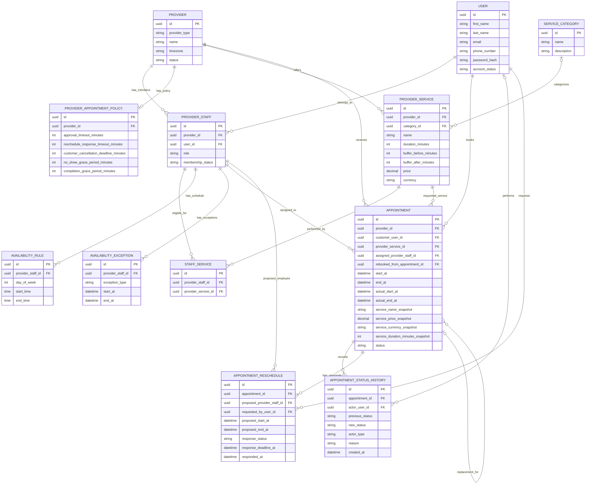

# SlotWise — Logical Entity Relationship Diagram

**Version:** 1.0  
**Status:** Draft

## 1. Overview

This diagram represents the logical relationships between SlotWise entities.

It includes provider management, service management, employee eligibility, availability management, appointment booking, appointment lifecycle history and rescheduling.

## 2. Logical ER Diagram

## 3. Relationship Constraints

The logical relationships above imply the following business constraints:

1. A user can have multiple provider memberships.
2. A provider can have multiple employees.
3. A provider has at most one appointment policy record.
4. An employee can be eligible for multiple services.
5. A service can be performed by multiple employees.
6. An appointment must belong to one provider, one customer, one service and one assigned employee.
7. An appointment can have multiple status history records.
8. An appointment can have multiple rescheduling proposals over its lifetime.
9. Only one rescheduling proposal may be pending for an appointment at a time.
10. A rescheduling proposal may assign a different eligible employee.
11. A replacement appointment can reference the rejected appointment from which it originated.

## 4. Important Notes

- Service snapshot fields are stored directly in `APPOINTMENT`; they do not create a separate relationship.
- `APPOINTMENT_RESCHEDULE` stores proposed changes. It does not replace the original appointment record.
- The original appointment's employee and schedule remain unchanged while a reschedule proposal is pending.
- Availability slots are dynamically generated and are not stored as permanent database records.
- Temporary reservations must be protected against concurrent booking requests.
- The 15-minute slot interval is a platform-wide setting, not an entity-specific attribute.

## 5. Next Design Phase

After validating this logical ERD, the next phase is physical database design.

This will define:
- PostgreSQL data types.
- Primary and foreign key constraints.
- Unique constraints.
- Check constraints.
- Indexes.
- Database-level protection against overlapping employee reservations.
- Database enforcement of one pending reschedule per appointment.